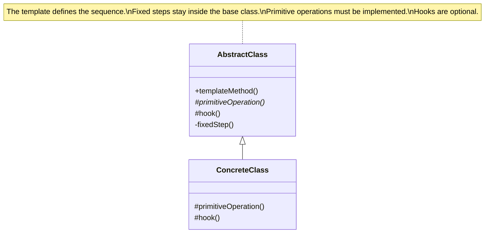
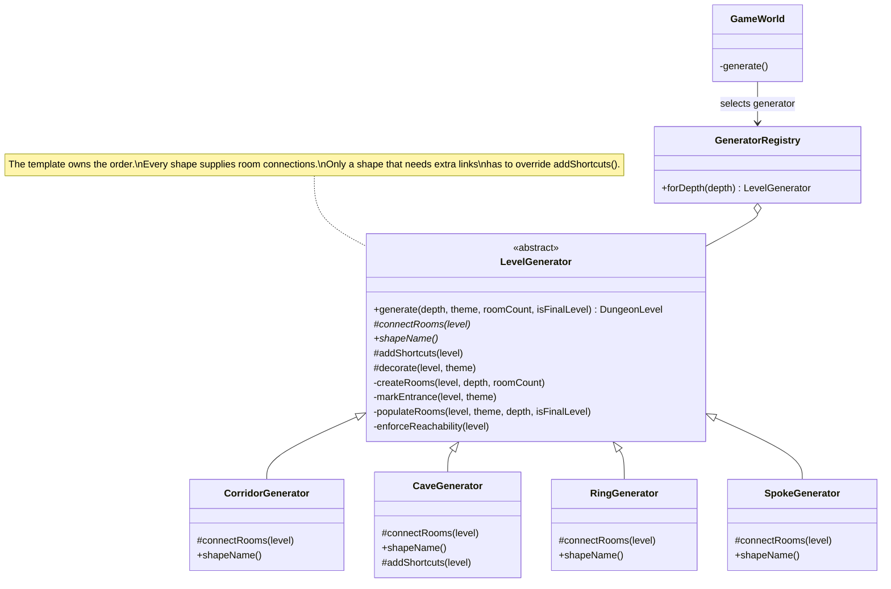

# The Template Method Pattern

## Video Goal

Understand how the Template Method pattern defines the **skeleton of an algorithm in one place**, allowing subclasses to customize selected steps without changing the order in which the algorithm runs.

By the end, you should be able to explain why this is more than extracting helper methods, distinguish fixed steps from primitive operations and hooks, and describe how `final` and `private` help enforce the design in Java.

## 1. The Problem: Algorithms Can Drift

Imagine three methods that generate different kinds of dungeon levels. Each one creates rooms, connects them, sets the entrance, populates the rooms, and checks that every room is reachable.

Most of the code is identical. Only the way the rooms connect genuinely needs to vary.

When each method contains its own copy of the algorithm, each copy can accidentally omit or reorder a step. One generator might forget the reachability check; another might populate the entrance with monsters. Both methods can compile perfectly, because each is valid Java. The problem is not necessarily a syntax error. It is that the copies no longer follow the same algorithm.

Extracting shared helper methods reduces duplicated code, but it does not fully solve the problem if each generator still decides which helpers to call and in what order. A new generator can still omit a step.

**Template Method solves the problem by giving one class ownership of the algorithm's order.**

## 2. The Core Idea

The Template Method pattern defines an algorithm in a method of a base class. That method calls a sequence of other operations: some are fixed, while others are implemented or optionally overridden by subclasses.

The base class controls **when** each step runs. Subclasses control selected parts of **what happens** during those steps.

A familiar analogy is a recipe: the instructions establish the order—prepare, cook, and serve—while allowing particular ingredients or techniques to vary. The variations do not get to rewrite the recipe's entire sequence.

### UML: The Pattern's Basic Structure



The important relationship is inheritance. `ConcreteClass` inherits the overall algorithm, implements required operations, and may customize optional ones. When the template method calls an overridable operation, Java's polymorphic method dispatch selects the subclass's implementation.

## 3. The Template Method and Its Steps

The **template method** is the method that defines the algorithm's overall sequence. The methods it calls typically fall into three categories.

| Kind of step | Java implementation | Meaning |
|---|---|---|
| **Fixed step** | `private` concrete method | The base class performs this step. Subclasses cannot override it or call it directly. |
| **Primitive operation** | `abstract` method | Each concrete subclass must supply the behavior. Leaving it unimplemented prevents that subclass from compiling. |
| **Hook** | Concrete method with an empty default body | A subclass may override the step, but it can also inherit the default behavior without implementing anything. |

A concrete operation can also be inherited as ordinary, already-implemented behavior. In the DungeonForge design, the fixed steps and hooks are both concrete methods, but they have different purposes: fixed steps enforce shared behavior, while hooks provide optional extension points.

### Primitive operations versus hooks

The difference is obligation.

An abstract primitive operation says, **"Every concrete subclass must decide how this step works."** A hook says, **"A subclass may customize this step, but doing nothing is valid."**

For example, every dungeon generator must connect its rooms somehow, so `connectRooms()` is a primitive operation. Only some shapes need extra connections beyond their basic structure, so `addShortcuts()` can be a hook with an empty default implementation.

A hook should represent a meaningful, optional variation—not simply another method added in anticipation of a hypothetical future requirement.

## 4. Why `final` Matters in Java

In Java, marking the template method `final` prevents subclasses from overriding it.

```java
public final DungeonLevel generate(...) {
    createRooms(...);
    connectRooms(...);
    markEntrance(...);
    populateRooms(...);
    addShortcuts(...);
    decorate(...);
    enforceReachability(...);
    return level;
}
```

The sequence above is illustrative of the design in DungeonForge. The essential point is that the order is written **once**, and a subclass cannot replace the method with its own version that skips or rearranges steps.

Without `final`, a subclass could override `generate()`, write its own sequence, and omit an operation that every generated level must perform. The base class would still contain the intended algorithm, but it would no longer guarantee that subclasses use it.

In this design, `final` protects an **invariant**—a condition that must remain true for every generated level. Reachability must be enforced, and the entrance must be left unpopulated. These are not optional preferences for individual generators.

The guarantee is stronger when fixed operations are also `private`. A `protected` helper can be called by a subclass at the wrong time, called twice, or not called at all. A `private` step stays under the template's control.

`final` is not a universal requirement of every implementation of Template Method, but it is load-bearing when the design depends on preventing subclasses from changing the algorithm's sequence.

## 5. The Hollywood Principle: "Don't Call Us, We'll Call You"

Template Method demonstrates the **Hollywood Principle**: *Don't call us, we'll call you.*

The high-level algorithm controls the process. It calls the subclass's primitive operations and hooks at the appropriate moments. The subclass supplies the varying behavior, but it does not take over the overall sequence.

This is also an example of **inversion of control**. Instead of each concrete generator driving the algorithm by calling a series of shared helpers, the base class drives the algorithm and calls the concrete implementation where variation is expected.

Think about the direction of responsibility:

- The base class decides **when** room connections happen.
- The subclass decides **how** the particular shape is connected.
- The base class continues with the remaining steps, including the final reachability check.

The subclass does not call `generate()` to orchestrate the process. The template method calls down into the subclass at the designated extension points.

## 6. How Template Method Appears in DungeonForge

DungeonForge uses Template Method to centralize dungeon-level generation. `LevelGenerator` owns the invariant sequence, while concrete generators provide different room layouts.

### UML: The DungeonForge Design



The registry selects a generator, while `LevelGenerator.generate()` runs the shared algorithm. These are separate responsibilities: selecting which generator to use is not the same as defining how every level must be built.

The four shapes differ in their room connections. The cave generator also overrides `addShortcuts()` to create extra connections. The other generators can inherit the empty hook because they do not need that additional behavior.

Most importantly, all generators inherit the same room creation, entrance handling, population rules, and reachability enforcement. The generator for a particular shape is no longer responsible for remembering those steps.

That matters because **the solution does not merely repair the old algorithms—it removes the duplicated algorithms that allowed them to drift**. A fourth shape can be introduced as a new subclass and registered without modifying the shared generation sequence.

### A Template Method You Already Wrote

The same idea appeared earlier in `AbstractCommand.execute()`. That final method establishes the order for a command turn: capture the snapshot when appropriate, run `doExecute()`, and allow monster turns only if the action succeeds. Concrete commands supply their own `doExecute()` behavior.

This is Template Method even though the project introduced it before formally naming the pattern. The fixed sequence protects gameplay rules—for example, undo needs the snapshot to be captured before the action changes the game.

## 7. Which OOP Principles Does It Represent?

**Abstraction.** The base class captures the general algorithm without requiring every detail to be identical. It expresses what happens overall while leaving selected operations abstract.

**Inheritance.** Concrete subclasses reuse the base class's implementation and specialize the extension points. Template Method is explicitly an inheritance-based pattern.

**Polymorphism.** Calls from the template to overridable methods execute the appropriate subclass implementation. The same `generate()` method can therefore produce different layouts.

**Encapsulation and invariant protection.** The template hides and controls fixed operations. In the Java design, `private` prevents subclasses from reaching fixed helpers, while `final` protects the method that coordinates them.

**Don't Repeat Yourself (DRY).** Shared algorithm steps have a single implementation. This reduces the chance that different copies will acquire different bugs or behavior over time.

**Open/Closed Principle (OCP).** The design supports adding new shapes by extending `LevelGenerator`, rather than editing the existing algorithm. That is a useful application of the principle, not an absolute guarantee: a genuinely new requirement may still require changing the template itself.

These principles reinforce one another. Inheritance and polymorphism make variation possible; the template method and access modifiers preserve the parts that should not vary.

## 8. Template Method Compared with Related Patterns

Template Method, Strategy, and Factory Method can all vary behavior, but they solve different design problems.

| Pattern | What varies? | How does it vary? | Example in DungeonForge |
|---|---|---|---|
| **Template Method** | Selected steps within a fixed algorithm | Inheritance; the subclass is chosen when the object is created | `LevelGenerator` |
| **Strategy** | The algorithm or policy used for a task | Composition; a strategy can often be swapped at runtime | `CombatStrategy` |
| **Factory Method** | Which object is created | A subclass customizes a creation step | `RoomPopulator` |

A useful distinction is **fixed sequence versus swappable policy**. Template Method says, "Follow this algorithm, but customize these steps." Strategy says, "Use this particular algorithm or policy for the task."

Factory Method is closely related: it can be understood as a specialized template in which a deferred step creates an object. It is commonly treated as its own pattern because its focus is object creation.

## 9. When Should You Use Template Method?

Template Method is a good candidate when:

- Several implementations share a recognizable sequence of steps.
- Some steps differ by implementation, while other steps must remain consistent.
- Shared invariants matter, and omissions or reordered steps would cause defects.
- You want a new implementation to supply only the behavior that genuinely varies.

Avoid it when the algorithms differ so much that very little is shared, when subclasses need to reorder major steps freely, or when behavior must change dynamically on an existing object. In those situations, a different design—often Strategy or composition—may fit better.

Do not confuse the pattern with simply extracting helper methods. Helper extraction centralizes the implementation of individual steps. Template Method additionally centralizes **the authority to decide the sequence**.

## 10. Criticisms and Trade-offs

Template Method is useful partly because it restricts freedom. That restriction is also its central cost.

**Subclasses cannot change the step order.** If a future level shape needs to populate rooms before connecting them, the current template does not allow that variation. You must reconsider the algorithm or add a deliberately designed extension point. Relaxing the restriction may mean losing the guarantee that every generator follows the same sequence.

**It relies on inheritance.** A subclass inherits the base class's design choices and must conform to its extension points. In Java, single inheritance also limits what else the subclass can extend. You cannot freely combine two independent implementations as though they were interchangeable components.

**The base class can become difficult to maintain.** Too many hooks create a template full of exceptions, weakening the consistency it was intended to provide. A poorly designed base class can also be fragile: changing its sequence or extension points may unexpectedly affect subclasses.

**The abstraction can be premature.** Two similar methods do not automatically justify a framework. The variation must be understood well enough to decide which steps are truly fixed, which are required, and which are optional.

The goal is not maximum restriction. It is to protect the rules that should be shared while leaving meaningful variation to the subclasses.

## 11. The Pattern in One Sentence

**Template Method puts the order of an algorithm in one place and delegates selected steps to subclasses, so behavior can vary without allowing every implementation to reinvent the process.**

Keep three questions in mind when examining a Template Method design:

1. Which parts of the algorithm must always happen?
2. Which parts must every subclass implement, and which are optional?
3. What prevents a subclass from bypassing the shared sequence?

When you can answer those questions from the class design—not merely from a comment—you understand both the mechanism and the purpose of the pattern.