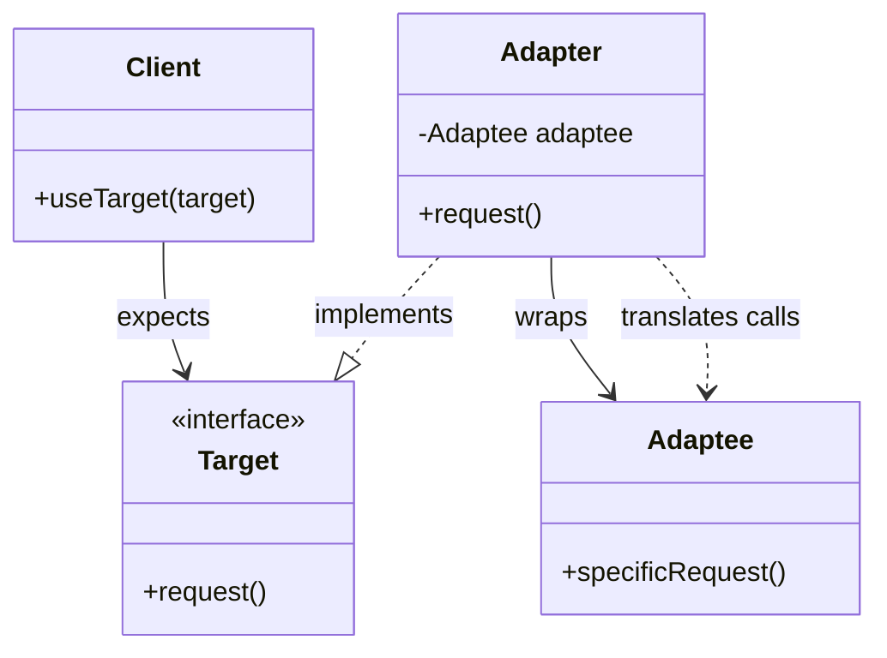
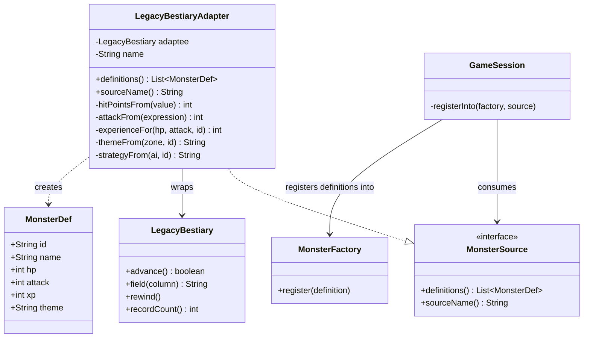
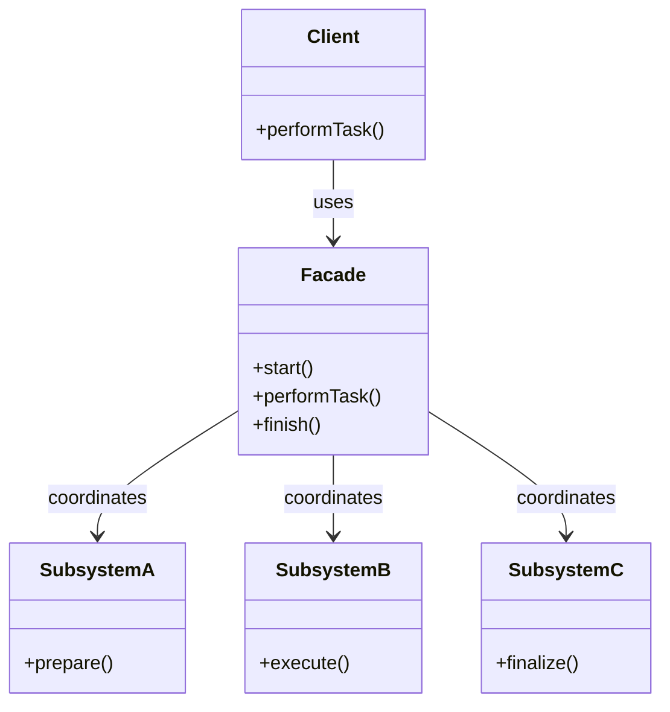
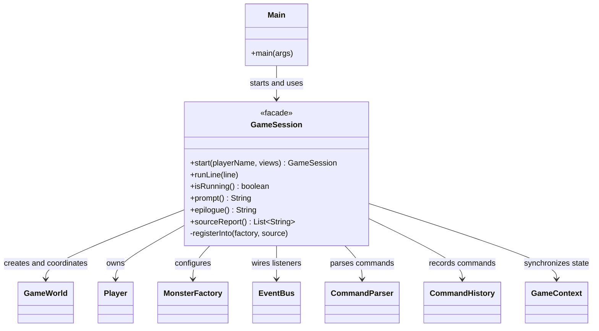

# Adapter and Facade Design Patterns

## Video Goal

Understand how the Adapter and Facade patterns organize objects to make existing code easier to integrate and use.

By the end, you should be able to explain why these are **structural patterns**, distinguish adapting an interface from simplifying a subsystem, describe how both can support the Principle of Least Knowledge, and recognize their trade-offs in a real object-oriented design.

## 1. The Problem: Code Can Be Correct and Still Not Fit

Imagine that DungeonForge has a working `MonsterFactory`. It expects monster definitions in the form of `MonsterDef` objects, each containing values such as hit points, attack strength, experience, and theme.

A developer discovers an old bestiary from a previous version of the game. Its data is useful, but its interface is incompatible with the current system: the old class exposes one record at a time, uses column names such as `"HIT_DICE"`, and returns every field as a `String`.

The factory is not broken. The legacy reader is not necessarily broken either. **The problem is that their interfaces do not fit together.**

Now consider a different problem. DungeonForge's entry point needs to create a player, configure a world, register monster sources, construct an event system, subscribe listeners, and coordinate command execution. Every subsystem may work correctly, but making callers understand all those details introduces unnecessary complexity—and repeated setup creates opportunities for omissions.

These are two different problems, which is why they need two different patterns.

- **Adapter:** Make an existing class usable through an interface the client expects.
- **Facade:** Give clients a simpler entry point to a collection of collaborating classes.

## 2. Why These Are Structural Patterns

Structural design patterns concern how classes and objects are composed and related to one another to form a larger design.

Adapter and Facade both put an intentional layer between a client and other objects, but that layer has a different purpose in each pattern.

Adapter introduces a translation layer between incompatible interfaces. Facade introduces a higher-level interface that coordinates a subsystem.

Neither pattern is primarily about selecting an algorithm, as Strategy does, or defining an algorithm's sequence, as Template Method does. Their central concern is **how objects are arranged so the rest of the system can work with them more cleanly**.

## 3. The Adapter Pattern: Make Interfaces Compatible

The Adapter pattern converts the interface of an existing class into another interface that a client expects.

Think of a travel power adapter: it lets a plug connect to a socket with a different shape. It does not change the underlying appliance or the electrical system into something entirely new. It provides a compatible connection between them.

In OOP, an adapter implements the **target interface** expected by the client and communicates with an existing object called the **adaptee**.

### UML: The Adapter Pattern



The client speaks the language of `Target`. The adapter implements that language and translates requests into the operations that `Adaptee` actually provides.

The key relationship is composition: the adapter **has an adaptee**. The client does not need to know the details of the original API.

### The Adapter's responsibilities

A useful adapter generally has four responsibilities:

1. Implement the target interface that the client expects.
2. Hold or otherwise access the existing object being adapted.
3. Translate method calls, arguments, return values, or data representations as needed.
4. Handle incompatibilities honestly, including missing information or unsupported operations.

The adapter should not simply move the old interface's vocabulary into the new interface. If `MonsterSource` exposes `"HIT_DICE"` and `"MOB_ID"` as part of its contract, the legacy API has leaked into the new abstraction. Another source would then have to imitate the old file format rather than provide monster definitions in the form DungeonForge expects.

## 4. Adapter in DungeonForge: The Legacy Bestiary

DungeonForge uses `LegacyBestiaryAdapter` to connect an old bestiary reader to the current `MonsterSource` interface.

The old `LegacyBestiary` works as a cursor: `advance()` moves to a record, and `field("HIT_DICE")` retrieves a value as a string. The current system expects a collection of `MonsterDef` objects with properly interpreted values.

The adapter translates between those two representations without modifying the legacy reader or the existing `MonsterFactory`.

### UML: The DungeonForge Adapter



The translation is not merely a matter of renaming methods. The adapter reads old fields, parses values, converts old identifiers to the current format, maps zones and AI names, and constructs `MonsterDef` objects.

For example, a simplified use of the target interface looks like this:

```java
MonsterSource source = new LegacyBestiaryAdapter(
    new LegacyBestiary("bestiary.csv"),
    "bestiary.csv (0.4 export)"
);

for (MonsterDef definition : source.definitions()) {
    factory.register(definition);
}
```

Notice what this code does **not** need to know: how the legacy reader advances through records, which column contains hit dice, or how the old file encoded damage. Those details belong to the adapter.

In the supplied reference, the adapter allows ten additional monster blueprints to enter DungeonForge, increasing the factory's blueprint count from 19 to 29. `MonsterFactory` itself remains unchanged.

### The Adapter's honest limitation: translation cannot recover missing information

An adapter can translate information that exists, but it cannot recover data the source never contained.

The legacy bestiary has no experience-point (`xp`) column. DungeonForge still needs an experience value, so the adapter derives one from hit points and attack strength and records that the value is derived in `translationNotes()`.

Other mismatches need decisions, too. The old `SAPPER` behavior has no direct counterpart in the current game's AI strategies, so the adapter uses a fallback strategy and records the mismatch. Old damage expressions such as `2d6+3` must also be represented as a single attack value in the current `MonsterDef` model, losing the original distribution of possible rolls.

There are three general choices when the target requires information or behavior that the adaptee cannot supply:

- **Refuse:** reject the record or throw an exception when the mismatch cannot be handled safely.
- **Derive or translate:** calculate an appropriate value and document the assumptions.
- **Default:** supply an explicit fallback value or behavior when that is acceptable.

A silent default is particularly dangerous because the caller may mistake an invented value for accurate source data.

**The Adapter's job is compatibility, not pretending that two systems are identical.**

## 5. The Facade Pattern: Give a Complex Subsystem a Simpler Front Door

The Facade pattern provides a unified, higher-level interface to a subsystem made up of multiple classes.

A facade is like the front desk of a large organization. You do not need to know which department handles every request or how the departments coordinate. You communicate with the front desk, which knows how to route the work.

In software, a facade offers operations that make common tasks straightforward without requiring the caller to construct, configure, or coordinate every subsystem object.

### UML: The Facade Pattern



Unlike an Adapter, a Facade does not have to implement a particular interface expected by the client or wrap one specific object. It can coordinate many existing objects and expose a smaller set of useful operations.

The subsystem classes can remain available for specialized callers. The facade offers a convenient entry point; it does not necessarily replace or conceal every class behind it.

## 6. Facade in DungeonForge: `GameSession`

Before `GameSession`, the game's entry point needed to know how to assemble and coordinate many parts of the game. That included building the player and world, registering monster definitions, setting up the event bus and listeners, creating the command parser and history, and connecting the game context.

There was another, more consequential problem: interactive play and scripted play each implemented the command-turn sequence. One path synchronized the game state after executing a command; the other omitted that step. As a result, a script could move past a living hostile even though the same command would be refused during interactive play.

The Facade improvement is not simply that `Main` became shorter. It is that setup and the common command-turn sequence now have a single owner.

### UML: The DungeonForge Facade



From `Main`, starting the game becomes a single call:

```java
GameSession session =
    GameSession.start(name, new ConsolePrinter());

session.runLine(line);
```

The client no longer needs to know the order in which all the collaborators are constructed. Nor do the interactive loop and script runner independently implement the turn's rules.

`GameSession.runLine()` centralizes the sequence: parse the command, execute it, record it in history, and synchronize the current game state. A script and an interactive player now pass through the same turn logic.

The same idea applies to startup. `GameSession.start()` assembles the session and registers its event listeners. One earlier omission—a `DamageMeter` that existed but had never been subscribed—was corrected in this shared setup.

This does not mean the new code cannot be wrong. It means there is one place to inspect and test when the setup or sequence changes. Tests must still verify behavior, such as whether the damage warning actually fires, rather than relying only on the number of subscription calls.

## 7. The Principle of Least Knowledge: The Law of Demeter

The **Principle of Least Knowledge**, commonly associated with the **Law of Demeter**, encourages an object to communicate with its immediate collaborators rather than depending on the internal structure of distant objects.

A practical summary is: *talk to your immediate friends, not to your friends' friends.*

For example, a client that must construct a factory, register every source, build a world, configure an event bus, and maintain command-state synchronization knows a great deal about the internal arrangement of the game.

A design that lets the client call `GameSession.start()` and `session.runLine()` gives it a much smaller set of responsibilities. It no longer needs to know how the underlying collaborators work together.

Adapter and Facade support this principle in different ways.

**Adapter limits knowledge of an incompatible external interface.** The client works with `MonsterSource`, not the legacy reader's cursor and column names.

**Facade limits knowledge of subsystem coordination.** The client works with `GameSession`, not the sequence of setup and turn operations distributed across many classes.

Neither pattern automatically guarantees compliance with the Law of Demeter. A Facade that exposes every subsystem through getters may encourage callers to navigate back into its internals. For instance, chains such as `session.getContext().getWorld()` make the caller dependent on the internal object graph.

The goal is not to forbid every chained method call. It is to reduce unnecessary knowledge of how other objects are organized.

## 8. Adapting Versus Simplifying

This is the most important distinction between the two patterns.

| Question | Adapter | Facade |
|---|---|---|
| **What problem does it solve?** | Interfaces do not match | A subsystem is cumbersome to use |
| **Primary purpose** | Compatibility | Simplicity and coordination |
| **What does it connect?** | A client-facing target interface and an incompatible adaptee | A client and several subsystem objects |
| **What does the client learn?** | The target interface, rather than the legacy interface | The facade's smaller API, rather than the subsystem's coordination details |
| **Typical implementation** | Implements the target interface and holds the adaptee | Exposes higher-level operations that coordinate collaborators |
| **DungeonForge example** | `LegacyBestiaryAdapter` | `GameSession` |
| **Main risk** | Incorrect or lossy translation | An oversized facade that accumulates too much responsibility |

An Adapter generally preserves the underlying capability while translating how the client accesses it. A Facade provides a more convenient way to perform a task, potentially coordinating several operations in a particular order.

You would use an Adapter if you had a new monster source with a different interface. You would use a Facade if callers should not have to assemble a game or independently coordinate a turn.

One does not replace the other. In DungeonForge, the Facade can consume a source through its target interface, while the Adapter makes the legacy source compatible with that interface.

## 9. Adapter Versus Decorator

Adapter and Decorator can look remarkably similar in code: both often hold another object and implement an interface. Their intentions are different, however.

A useful question is: **Does the wrapper implement the same interface as the object it holds?**

| Feature | Adapter | Decorator |
|---|---|---|
| **Purpose** | Make an incompatible interface usable | Add or alter behavior while preserving an interface |
| **Implements** | The target interface expected by the client | The same component interface as the wrapped object |
| **Holds** | An adaptee with an incompatible interface | A component of its own interface |
| **Main operation** | Translates requests and representations | Delegates, extends, or modifies behavior |
| **DungeonForge example** | `LegacyBestiaryAdapter implements MonsterSource`, holds `LegacyBestiary` | `WeaponDecorator implements Weapon`, holds `Weapon` |

In Week 9, `FlamingWeapon` wraps a `Weapon` and is itself still a `Weapon`. That is why enchantments can be nested, such as `Flaming(Frost(sword))`.

In Week 12, `LegacyBestiaryAdapter` implements `MonsterSource` but holds a `LegacyBestiary`. The adapter is not itself a `LegacyBestiary`, and its constructor expects that legacy type. You cannot nest the adapter as though it were another legacy reader.

This is the key conceptual distinction:

- **Decorator:** same interface, additional behavior.
- **Adapter:** different interface, translated access to existing capabilities.

An Adapter is not just a Decorator with different method names. It changes the interface through which a client uses an object, rather than preserving that interface in order to add behavior.

## 10. Which OOP Principles Do These Patterns Represent?

### Adapter

**Abstraction and programming to an interface.** Clients depend on `MonsterSource` rather than on the legacy reader's concrete API. The target interface describes what the application needs, not how a particular data source represents it.

**Encapsulation.** File formats, legacy column names, parsing rules, and translation decisions stay inside `LegacyBestiaryAdapter` instead of spreading throughout the game.

**Composition over inheritance.** The adapter holds the object it adapts. It does not need to inherit from the legacy implementation to reuse its functionality.

**Dependency management and the Open/Closed Principle.** The existing factory can continue registering `MonsterDef` objects without learning which file format supplied them. Adding another source can be accomplished with another implementation of `MonsterSource`, rather than changing every class that consumes monster definitions.

### Facade

**Encapsulation and information hiding.** The facade gives callers a higher-level operation without requiring them to know every step of the underlying implementation.

**Low coupling and the Principle of Least Knowledge.** Callers depend on the facade's public API instead of on every collaborating class and the order in which those classes are used.

**Single responsibility, applied carefully.** The facade can give session setup and coordination a clear owner. It should not become a place where unrelated game rules, data transformations, rendering, and domain logic accumulate simply because the class already knows about many objects.

**Don't Repeat Yourself (DRY).** Shared sequences, such as command execution and state synchronization, can be implemented and tested in one place rather than being repeated in separate callers.

These are design principles, not automatic rewards for using a pattern. An adapter can still contain poor conversion logic, and a facade can still become tightly coupled and difficult to test. The quality depends on the responsibilities and boundaries that the design establishes.

## 11. When Should You Use Each Pattern?

### Use Adapter when:

- You need to reuse a legacy or third-party class whose interface does not match your own.
- You cannot or should not modify the existing class.
- You want different data sources or services to satisfy the same target interface.
- You can identify the required translation rules and decide how to handle incompatibilities honestly.

Avoid an Adapter when the interfaces already fit, or when the adapter must contain so many exceptions and transformations that the target abstraction no longer accurately describes the source.

### Use Facade when:

- Clients must coordinate several classes to perform a common task.
- Setup or operation sequences have been duplicated across callers.
- Callers know too much about the order in which subsystem components must be used.
- You want a convenient, stable entry point without eliminating the subsystem's lower-level APIs.

Avoid a Facade that merely collects every method and every object into a giant class. If the facade becomes a universal gateway for unrelated operations, it can turn into a **God Object**—a class with too many responsibilities and too much knowledge.

## 12. Criticisms and Trade-offs

### Adapter does not eliminate complexity; it contains it

The translation has to happen somewhere. An Adapter makes the legacy interface less visible to clients, but the adapter itself must understand the old API, map values correctly, and decide what to do when a value or operation has no equivalent.

Conversions can lose information. If the old system supports a behavior the new system cannot represent, the adapter must not quietly imply that the capability has been preserved. Derived values, fallbacks, and rejected records should be deliberate, documented decisions.

There is also an abstraction cost: a new interface and adapter class create more types and more code to maintain. That cost is justified when the boundary is useful—not merely because every mismatch deserves another class.

### Facade relocates coupling; it does not erase it

The Facade simplifies the caller, but the facade must know how its collaborators fit together. `GameSession` owns that setup and turn-sequence knowledge, which is precisely what lets `Main` remain simpler.

The trade-off is that `GameSession.start()` builds a complete session, including a world and its collaborators. A unit test that wants only a `Player` and an `EventBus` may find that setup unnecessarily expensive or difficult. A facade can also make diagnostics harder if callers previously reached directly into the subsystem to inspect individual objects.

The solution is not to abandon the pattern, but to design a narrow, coherent facade and retain appropriate lower-level access for tests and specialized use cases. Avoid exposing everything by default.

### Both patterns need tests at the right level

A class compiling does not prove that an adapter preserves the intended meaning of the source data. Likewise, a facade containing all expected method calls does not prove that it coordinates them in the correct order.

Test observable behavior: whether legacy monsters can actually appear in the game, whether unsupported data is handled deliberately, whether listeners fire, and whether scripted and interactive commands obey the same game rules.

The purpose of either pattern is not to make incorrect behavior impossible. It is to establish clearer boundaries, reduce unnecessary dependencies, and make correct behavior easier to maintain and verify.

## 13. The Patterns in One Sentence Each

**Adapter:** Make an existing object usable through an interface the client expects, translating between incompatible contracts without spreading legacy details throughout the system.

**Facade:** Give clients a simpler entry point to a complex subsystem, centralizing the coordination that callers should not have to repeat.

Remember the distinction:

**Adapter makes things compatible. Facade makes things simpler.**

Both are structural patterns because they improve how objects and interfaces fit together, but they address different kinds of coupling. Adapter isolates an interface mismatch; Facade centralizes knowledge of a subsystem's structure and coordination.