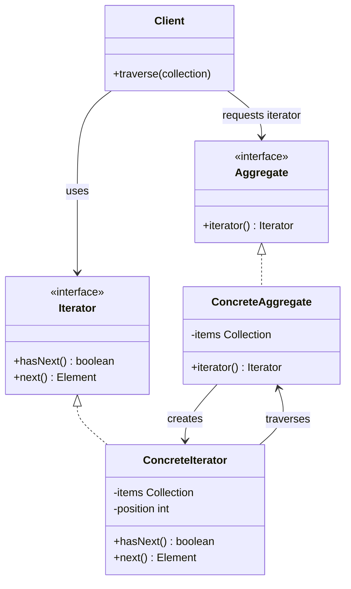
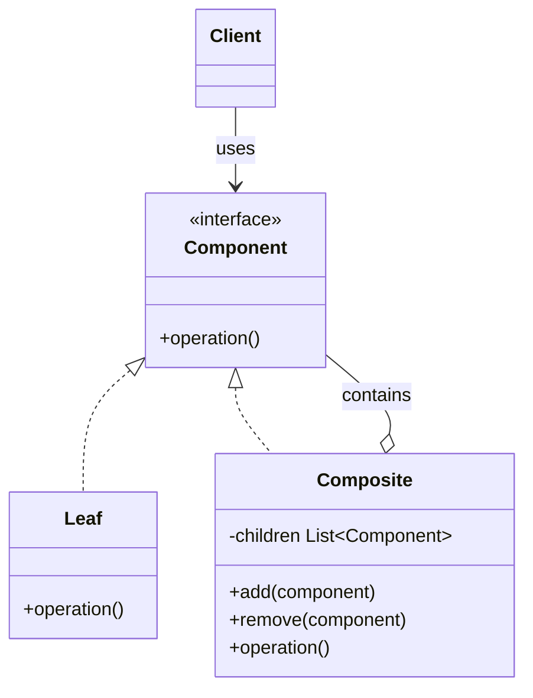
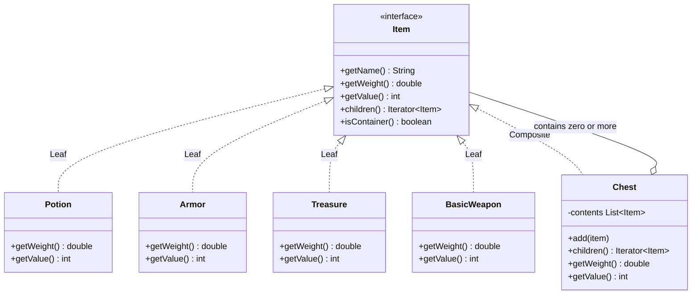
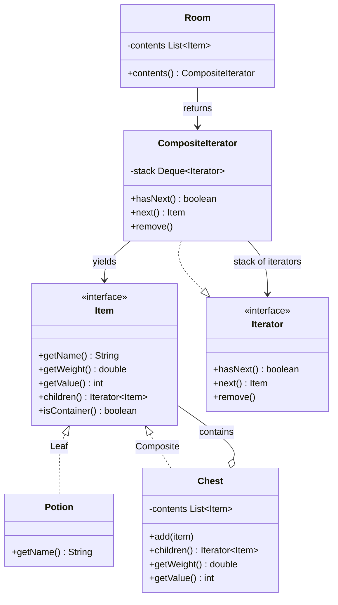

# Iterator and Composite Design Patterns

## Video Goal

Understand how the Iterator and Composite patterns organize access to collections and hierarchies of objects.

By the end, you should be able to explain why Iterator is a **behavioral pattern** and Composite is a **structural pattern**, how they support the Single Responsibility and Open-Closed Principles, and why the two patterns often work particularly well together.

Their central ideas are:

- **Iterator:** Provide one consistent way to traverse a collection without exposing how it is stored.
- **Composite:** Let clients treat an individual object and a collection of nested objects through the same interface.

## 1. The Problem: One Thing, or a Collection of Things?

Imagine a room in DungeonForge. It contains items lying on the floor and may also contain a chest filled with other items.

The game can describe the chest. It can even let the player take an item out of it. But in the original design, `Chest` is not an `Item`. The player cannot pick it up, the inventory cannot account for its weight, and the game must maintain separate logic for floor items and chest contents.

There is a second problem: every class that needs to find or process items must know that a room stores them in two different places. Some classes repeat nearly identical loops, and some forget to process one of the collections altogether.

These are related problems, but they are not identical:

- **Iterator** addresses how objects are traversed.
- **Composite** addresses how objects are organized and treated when some objects contain other objects.

Understanding that difference explains why the patterns appear together.

## 2. Why One Pattern Is Behavioral and the Other Structural

Design patterns are commonly grouped by the kind of design problem they address.

**Iterator is behavioral** because it encapsulates the behavior of traversing a collection. It defines how a client requests the next element without requiring the client to understand the collection's internal representation.

**Composite is structural** because it organizes objects into a part-whole hierarchy, typically a tree. It establishes how individual objects and groups of objects fit together and share a common interface.

A useful distinction:

- Iterator asks: **How should I move through these objects?**
- Composite asks: **How should these objects be organized so a single object and a group can be treated alike?**

## 3. The Iterator Pattern: Separate Traversal from Storage

The Iterator pattern provides a way to access the elements of a collection sequentially without exposing the collection's underlying representation.

For example, one collection might use an `ArrayList`, another might use an array, and another might represent a tree. A client should not need a different loop for each implementation.

Instead, the client works with an iterator that provides a small, consistent interface.

### UML: The Iterator Pattern



The iterator maintains the information needed to track traversal, such as its current position or the next collection to visit.

In Java, the standard `Iterator` interface provides methods such as:

| Method | Purpose |
|---|---|
| `hasNext()` | Determines whether another element is available. |
| `next()` | Returns the next element and advances the iterator. |
| `remove()` | Optionally removes the most recently returned element, when supported. |

A typical client does not need to know whether the collection is an array, list, or something more complicated:

```java
Iterator<Item> iterator = room.contents();

while (iterator.hasNext()) {
    Item item = iterator.next();
    System.out.println(item.getName());
}
```

The collection is responsible for providing access to its elements. The iterator is responsible for tracking and performing the traversal.

### External and internal iterators

Java's `Iterator` is an example of an **external iterator**: the client drives the traversal by calling `hasNext()` and `next()`.

An **internal iterator** places more of the traversal control inside the collection or operation. For example, a collection might provide a method that accepts a function and applies it to every element.

External iterators provide more control to the caller, including the ability to stop, skip, or remove elements during traversal. Internal iterators can make simple operations more concise.

You will primarily use Java's external iterator model in this course. One related Java distinction is that `Iterable` supplies an `iterator()` method, which is why an `Iterable` can be used directly in a for-each loop.

## 4. How Iterator Relates to SRP and OCP

### Single Responsibility Principle (SRP)

The Single Responsibility Principle says that a class should have one primary reason to change.

Without an iterator, a collection may have to manage both its data and the traversal logic required by every caller. An iterator separates those concerns:

- The collection manages its contents and storage.
- The iterator manages how elements are visited.
- The client decides what to do with each element.

If the collection's internal representation changes, the client can continue using the same traversal contract. If the traversal algorithm changes, that logic can be changed in the iterator rather than repeated across multiple clients.

This separation is the principal SRP motivation for Iterator.

### Open-Closed Principle (OCP)

The Open-Closed Principle says software entities should be open for extension but closed for modification.

Iterator supports this principle by allowing different collection implementations to provide the same traversal interface. A client written against `Iterator` does not need to be rewritten just because the underlying collection changes from one representation to another.

However, the abstraction has a limit: an iterator intentionally hides some structural information. A caller that needs to know *where* an item was stored, or distinguish a floor item from an item inside a chest, may need more than a flat iterator provides.

**An iterator is most useful when the caller is indifferent to the collection's internal structure.**

## 5. The Composite Pattern: Treat an Object and Its Parts Uniformly

The Composite pattern organizes objects into a tree-like structure so that individual objects and groups of objects can be treated through a common interface.

It is especially useful when the application has a natural part-whole relationship.

Think of a folder on a computer. A folder can contain files and other folders. A file is an individual object; a folder is an object that contains other objects. Yet both can participate in common operations such as reporting their name or calculating their total size.

Composite applies the same idea to object-oriented design.

### UML: The Composite Pattern



The pattern has three important roles:

| Role | Purpose |
|---|---|
| **Component** | Common interface shared by individual objects and containers. |
| **Leaf** | An individual object that does not contain other components. |
| **Composite** | An object that contains other components, including other composites. |

The client works with the Component interface rather than needing to know whether it has a Leaf or a Composite.

The Composite implements the common operations by coordinating its children. For example, if a folder reports its total size, it adds the sizes of its files and the totals reported by any subfolders.

The result is a tree in which the same operation can work at multiple levels.

## 6. Composite in DungeonForge: A Chest Becomes an Item

DungeonForge uses the `Item` interface as the Component, ordinary objects such as `Potion` and `Armor` as Leaves, and `Chest` as the Composite.

The significant design change is that `Chest` now implements `Item` and contains other `Item` objects—including other chests.

### UML: The DungeonForge Composite



The `Item` interface gives every item a common contract. A leaf has no children, so its default `children()` implementation can return an empty iterator. A `Chest` returns an iterator over its direct contents.

The important point is that a chest does not need to be treated as a special kind of object by every client. It is an `Item`, just like a potion or weapon.

### Recursive behavior belongs inside the Composite

A chest's weight includes its own empty weight, or *tare*, plus the weight of everything it contains:

```java
public double getWeight() {
    double total = tare;

    for (Item item : contents) {
        total += item.getWeight();
    }

    return total;
}
```

This is where polymorphism and recursion work together. If a child is another chest, that chest already knows how to calculate its own total weight. The outer chest simply asks each child for its weight.

The same idea applies to value.

A caller does not need to recursively inspect every nested container to calculate the weight of an item. It asks the item. The Composite takes responsibility for aggregating the values of its children.

**If you find yourself recursively traversing a Composite from outside the Composite just to calculate its aggregate behavior, reconsider where that responsibility belongs.**

## 7. How Composite Relates to SRP and OCP

### Single Responsibility Principle (SRP)

Composite supports SRP by giving each kind of object a focused responsibility:

- A Leaf represents and reports the properties of one individual object.
- A Composite manages its children and provides aggregate behavior.
- A client requests operations through the common Component interface.

For example, `Chest` is responsible for maintaining its contents and calculating its combined weight and value. `TakeCommand` should not need to know how deeply nested those contents are just to retrieve an item.

There is an important complementary role for Iterator: traversal remains a separate responsibility instead of becoming duplicated across every Composite client.

The pattern does not prevent a Composite from becoming overloaded with unrelated responsibilities. A `Chest` should not also become responsible for command parsing, user-interface output, or undo history simply because it contains other objects.

### Open-Closed Principle (OCP)

Composite can strongly support OCP when the Component interface is stable.

New Leaf types or new Composite types can be added without changing clients that already operate on the Component interface. In DungeonForge, making `Chest` a Composite did not require modifying existing Leaf classes. The existing item types continued to implement `Item` without learning anything about nested containers.

This is one of the pattern's major advantages: **the hierarchy can grow without requiring every client to understand every new type.**

However, Composite has an important OCP limitation: adding a new operation to the Component interface may require changes to every class implementing it. The more general the Component interface becomes, the more difficult it can be to maintain.

This is why the design of the shared interface matters so much.

## 8. The Composite Design Trade-Off: Transparency Versus Safety

One of the most consequential Composite design decisions is deciding which operations belong on the Component interface.

Should every `Item` support `add()` and `remove()`? Or should only a `Chest` expose those operations?

There are two common approaches.

| Approach | Meaning | Advantage | Cost |
|---|---|---|---|
| **Transparency** | Put container operations on the Component interface. | Clients can work uniformly with any Component. | A Leaf may expose an operation it cannot meaningfully perform and throw at runtime. |
| **Safety** | Keep container operations on the Composite class. | Invalid operations on Leaves are prevented by the type system. | Callers must know they have a Composite before adding children. |

The classic textbook implementation often favors transparency. For example, `item.add(otherItem)` is available through the common interface, even though a `Potion` cannot contain another item. The Leaf may have to throw `UnsupportedOperationException`.

DungeonForge chooses safety: `add()` belongs to `Chest`, not to `Item`. A caller cannot accidentally call `add()` on a potion because that method is not available through the interface.

This is a deliberate trade-off, not a universal rule. A general-purpose library intended for unknown clients may value transparency and a uniform interface. A controlled application with a known set of callers may prefer compile-time safety.

The decision also relates to the **Interface Segregation Principle (ISP)**: clients and implementations should not be forced to depend on operations they do not need or cannot meaningfully support.

## 9. How Iterator and Composite Work Together

These patterns are taught together for a particularly good reason: **introducing Composite changes the structure that Iterator must traverse.**

DungeonForge illustrates this through three stages.

### Stage 1: Two flat collections

Originally, a `Room` stored loose floor items in one collection and a chest in another. Several classes had to know about both locations.

`TakeCommand`, for example, had separate methods for searching the floor and searching the chest.

### Stage 2: Iterator hides the original storage arrangement

`RoomContentsIterator` provided one traversal interface across the two collections.

The caller no longer needed separate search methods. It could ask for an iterator, search for an item, and remove the found item through `Iterator.remove()`.

That removal capability matters: without it, `TakeCommand` would have to determine which collection contained the item before deleting it, reintroducing the very knowledge the iterator was intended to hide.

Iterator also made it possible to write the traversal once. This helped close a defect in `totalLoot()`, which had counted chest contents but not loose floor items. The problem was not that Iterator magically found the bug; the unified traversal meant the floor branch could no longer be forgotten in a separate copy.

### Stage 3: Composite changes the data into a tree

The next change makes `Chest` an `Item`. A chest can now contain another chest, and that nested chest can contain more items.

The collection is no longer simply two flat lists. It is a tree.

The original `RoomContentsIterator` was designed for the old flat structure. It could not provide a complete traversal of the new hierarchy. This is not a reason to abandon Iterator; it is a reason to provide an iterator capable of traversing a Composite.

### UML: Iterator and Composite Together in DungeonForge



The `CompositeIterator` uses a stack of iterators to traverse nested containers. When it encounters a container, it yields that container and then pushes an iterator over its children.

This produces a **pre-order traversal**: a node is visited before its children.

That order matters in DungeonForge. When a player enters `take iron-bound`, the search should find the chest itself before finding something inside it. If the traversal visited the contents first, a matching name inside the chest could be selected before the chest.

The composite iterator also supports removal. It removes an item from the iterator that produced it, rather than requiring the caller to know where the item was stored. If the removed item is a container, its child iterator must also be removed from the traversal stack so the walk does not continue into a container that has already left the room.

The result is one traversal mechanism that can handle a room containing loose items, chests, and arbitrarily nested chests.

## 10. Not Every Operation Needs a Full Tree Walk

A composite iterator is a tool, not an obligation. Different operations may need different traversal depths.

DungeonForge makes this distinction with `take` and `loot`:

| Command | Traversal | Meaning |
|---|---|---|
| `take <name>` | Entire tree | Find this specific item wherever it is nested. |
| `loot` | Top level only | Take everything immediately in the room, including containers that bring their contents with them. |

Why not let `loot` walk the entire tree?

Because it would queue a take operation for the chest and for every item inside it. The chest would be taken first, and the subsequent requests for its contents would fail because those items would no longer be in the room.

The inventory weight calculation follows the same principle. `Player.carriedWeight()` sums the top-level inventory items because each chest already includes the weight of everything nested inside it. Recursively walking the inventory again would double-count those contents.

**Use the traversal that matches the meaning of the operation—not simply the deepest traversal available.**

## 11. The OOP Principles These Patterns Represent

The patterns reinforce several important object-oriented principles:

**Encapsulation.** Iterator hides the details of traversal and collection representation. Composite hides the internal organization of its children behind the Component interface.

**Abstraction.** Clients work with the `Iterator` and `Item` contracts rather than depending on specific collection or Leaf implementations.

**Polymorphism.** A `Chest` can be used anywhere an `Item` is expected. Calls such as `getWeight()` execute the correct Leaf or Composite implementation.

**Composition over inheritance.** A Composite contains other Component objects. It creates a part-whole relationship through object references, rather than relying on a complicated inheritance hierarchy.

**Single Responsibility Principle.** Iterator separates traversal from storage. Composite assigns the responsibility for maintaining children and aggregating their properties to the Composite itself.

**Open-Closed Principle.** New collection implementations and traversal implementations can satisfy the Iterator contract. New Leaf and Composite classes can satisfy the Component contract without forcing clients to learn every new class.

**Interface Segregation Principle.** The decision about whether `add()` belongs on `Item` illustrates the danger of forcing Leaf classes to expose operations that do not make sense for them.

These principles work together, but neither pattern automatically guarantees good design. The interfaces must still describe meaningful contracts, and responsibilities must remain cohesive.

## 12. When Should You Use Each Pattern?

### Use Iterator when:

- Clients need to traverse a collection without knowing how it is stored.
- Multiple callers repeat similar loops or search logic.
- You expect the underlying collection representation to change.
- You want traversal behavior maintained in one place.
- You need controlled modification during traversal, such as removing the current element.

Avoid adding an iterator simply to wrap a trivial loop when it provides no meaningful separation. Also avoid using a flat iterator for callers that genuinely need to know where elements are stored.

### Use Composite when:

- Your domain naturally contains objects made up of other objects.
- You need to represent a tree or part-whole hierarchy.
- Individual objects and containers share meaningful operations.
- You want operations such as weight, value, size, or rendering to work consistently across nested structures.

Avoid Composite when the relationship is not naturally hierarchical or when the shared interface becomes so general that Leaf objects must implement many meaningless operations.

## 13. Criticisms and Trade-Offs

### Iterator has a cost

An iterator introduces another object and an abstraction between the caller and the collection. For a simple collection, a direct loop may be easier to read and more efficient.

The abstraction becomes valuable when it removes duplicated traversal logic, hides meaningful implementation details, or supports a complex structure. Its benefits should justify the added layer.

Iterator also hides information. A caller that needs to distinguish a floor item from an item in a chest cannot necessarily rely on a traversal that yields only `Item` objects. That caller may need a more specific interface or direct access to the structure.

Removal is another design decision. Some iterators are read-only and should reject removal. DungeonForge's iterator must support it because `TakeCommand` needs to remove the item it finds without knowing which collection contains it. Whether `remove()` is supported should follow the needs of the callers.

### Composite has a cost

Composite can make a hierarchy much easier to use, but it also introduces decisions about which operations belong on the common Component interface.

Too much uniformity can weaken type safety. Too little uniformity can force clients to inspect concrete types before performing container operations.

Composite also assumes a tree-like part-whole relationship. More complicated relationships—such as shared children, cycles, or general graphs—may require different models or additional safeguards.

Finally, aggregate operations must be implemented carefully. Recursive behavior belongs in the Composite; having callers repeatedly traverse nested structures can reintroduce duplication and create problems such as double-counting.

### The most important trade-off

Both patterns reduce the amount of structural knowledge clients need, but neither makes that knowledge disappear.

Iterator moves traversal responsibility into an iterator. Composite moves the responsibility for managing and aggregating nested contents into the Composite. Their success depends on assigning those responsibilities to the right objects.

## 14. The Patterns in One Sentence

**Iterator:** Provide sequential access to a collection without exposing how the collection is represented or how traversal is performed.

**Composite:** Represent individual objects and nested groups through a common interface so clients can treat both uniformly.

Together, they let a client walk a collection of individual objects, containers, and nested containers without writing a new traversal algorithm for every level.

The mental model to remember:

**Iterator gives you one way to walk. Composite gives you one way to represent the tree. The Composite Iterator lets you walk the whole tree without making every client understand its branches.**