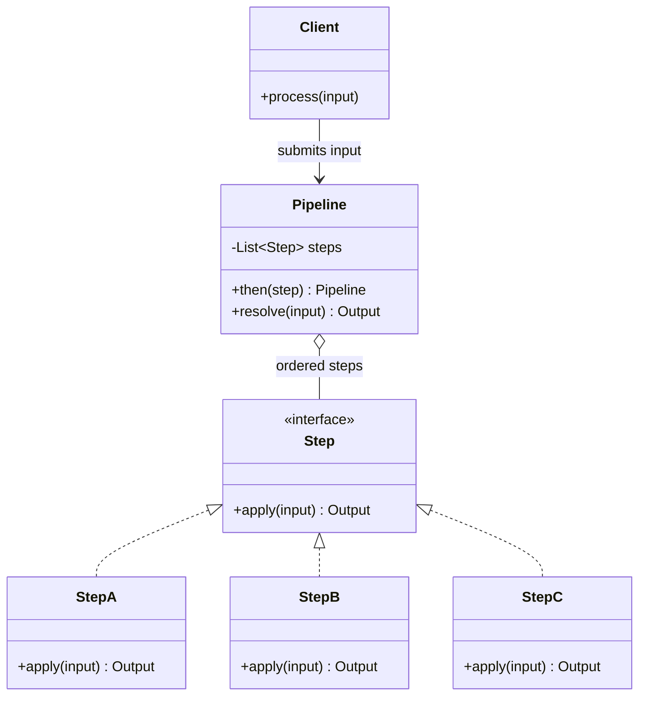
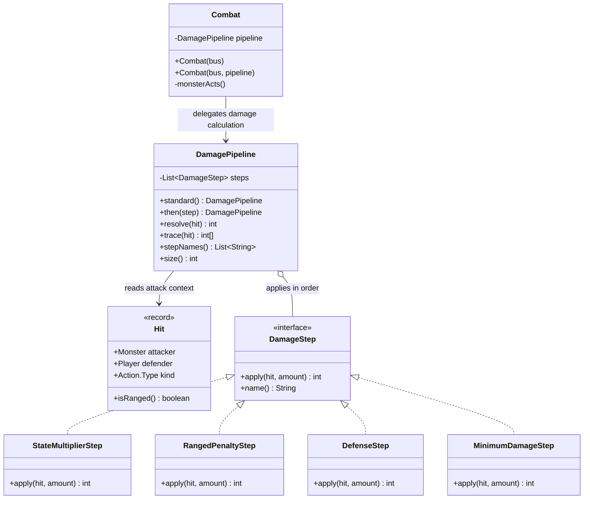
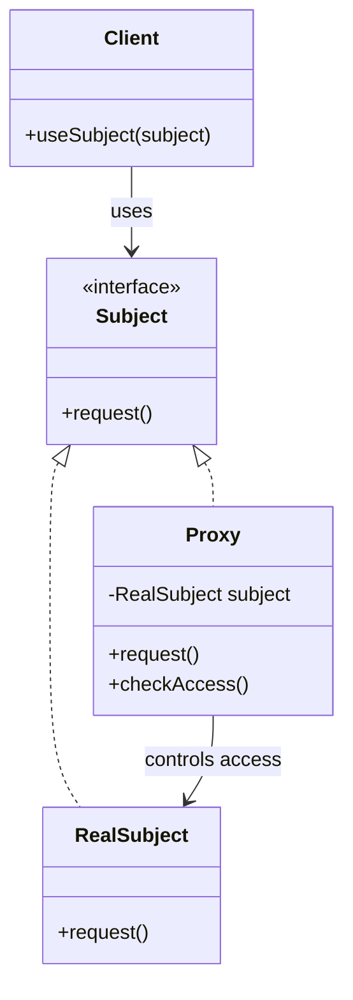
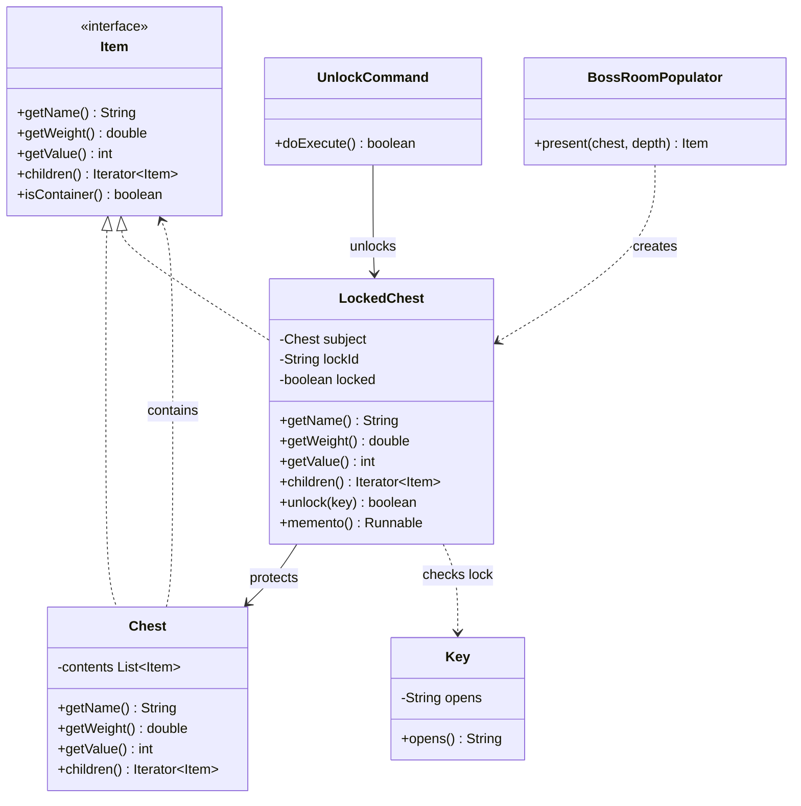
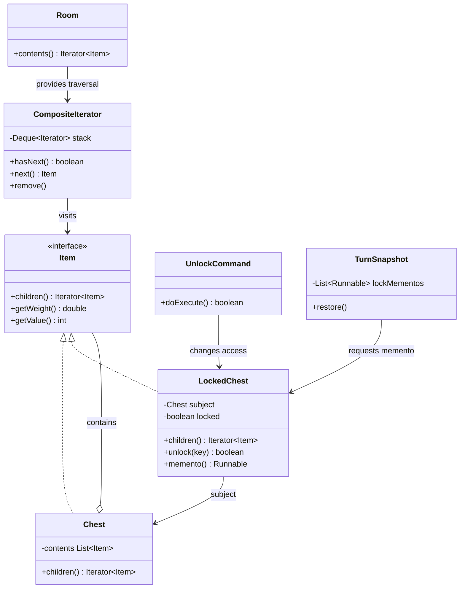

# Pipeline and Proxy Design Patterns

## Video Goal

Understand how the Pipeline and Proxy patterns use composition and abstraction to organize complex operations and control access to objects.

By the end, you should be able to explain how a pipeline applies a sequence of independent processing steps, how a proxy stands in for another object while controlling access to it, and how both patterns support good OOP design.

Their central ideas are:

- **Pipeline:** Pass data through an ordered sequence of processing steps, with each step transforming the result.
- **Proxy:** Provide a stand-in for another object that implements the same interface but controls how the real object is accessed.

Both patterns help separate responsibilities, but they solve different problems.

## 1. The Problems: Too Many Rules in One Place, and Access That Needs Protection

Consider two situations in DungeonForge.

First, a monster attacks the player. How much damage should the blow inflict?

The initial attack power is only the starting point. The monster's current state might increase or decrease its damage. A ranged attack might receive a penalty. The player's defense might reduce the damage. Finally, every successful hit must inflict at least one point of damage.

If all of those rules live in `Combat`, the class must know every damage calculation and the order in which those calculations happen. Adding a new rule means editing the same class again.

Second, consider the boss's treasure chest. The chest exists in the room, but its contents should remain inaccessible until the player obtains the correct key.

One approach is to add checks for a locked chest to every operation that might encounter it: taking items, describing a room, traversing contents, and looting. That would spread knowledge of the lock throughout the game.

These are different problems:

- **Pipeline** organizes a multi-step process so each processing rule has its own responsibility.
- **Proxy** controls access to an object without requiring every client to know about the access restriction.

## 2. Why These Patterns Are Structural

Structural patterns concern how objects are composed and how responsibilities are distributed across collaborating objects.

**Proxy is a classic structural pattern.** It introduces an object that stands in for another object. The proxy implements the same interface as the real object, holds a reference to it, and controls access to it.

**Pipeline is a compositional pattern.** It organizes independent processing steps into a defined sequence. The pipeline owns the structure and order of those steps, while each step owns one transformation.

There is a useful classification distinction here: Pipeline is not one of the original 23 Gang of Four patterns, and different design-pattern references classify it differently. It is often discussed as an architectural or processing pattern. In this lesson, its structural aspect is the composition of independent processing objects into an ordered flow. Its processing behavior also gives it a close relationship to behavioral patterns.

The important distinction is not the label alone, but what each pattern organizes:

- Pipeline organizes **processing stages and their order**.
- Proxy organizes **the relationship between a client and the object it accesses**.

## 3. The Pipeline Pattern: A Process Made of Independent Steps

A pipeline passes data through a sequence of processing stages. Each stage receives the current result, applies its own rule, and passes the updated result to the next stage.

Think of an assembly line. A product moves from one station to another. Each station performs a specific operation, and the result becomes the input to the following station.

A pipeline works the same way: the output of one step becomes the input of the next.

### UML: The Pipeline Pattern



The pipeline owns the sequence. Each concrete step implements the same interface, so the pipeline does not need to know the details of each operation.

A simplified implementation looks like this:

```java id="8xk3nb"
public interface ProcessingStep {
    int apply(int amount);
}

public final class Pipeline {
    private final List<ProcessingStep> steps = new ArrayList<>();

    public Pipeline then(ProcessingStep step) {
        steps.add(step);
        return this;
    }

    public int resolve(int amount) {
        for (ProcessingStep step : steps) {
            amount = step.apply(amount);
        }
        return amount;
    }
}
```

The implementation is deliberately straightforward. Its design strength comes from separating the individual rules and centralizing their order.

### Every step runs

A key characteristic of this kind of pipeline is that every step processes the data in sequence. A step transforms the running result; it does not decide whether the next step gets to run.

That distinction matters because a pipeline is related to, but not identical to, the classic Chain of Responsibility pattern.

In a classic Chain of Responsibility, a handler may deal with a request, decline it, or pass it along. The request may stop at one handler or continue depending on the handler's decision.

In this Pipeline implementation, every step runs unless the pipeline itself is explicitly designed with additional branching or termination behavior.

| | Pipeline | Classic Chain of Responsibility |
|---|---|---|
| Main purpose | Apply a sequence of transformations | Give handlers a chance to handle a request |
| Who controls continuation? | The pipeline | The current handler or chain |
| Does every stage run? | Yes, by default | Not necessarily |
| Typical result | A transformed value | A handled request or a forwarded request |

The two patterns belong to the same broader family of sequential processing ideas, but their responsibilities differ.

## 4. Pipeline in DungeonForge: Calculating Damage

DungeonForge uses Pipeline to determine the damage a monster inflicts on the player.

The process begins with the monster's attack power. That value travels through an ordered series of `DamageStep` implementations.

### UML: The DungeonForge Damage Pipeline



The four standard damage steps are:

| Step | Responsibility |
|---|---|
| `StateMultiplierStep` | Adjust damage based on the monster's current state. |
| `RangedPenaltyStep` | Reduce ranged attacks to 80% of their original strength. |
| `DefenseStep` | Subtract the player's defense from the incoming damage. |
| `MinimumDamageStep` | Ensure a successful hit inflicts at least one point of damage. |

The standard pipeline is assembled in this order:

```java id="n3f6vq"
public static DamagePipeline standard() {
    return new DamagePipeline()
        .then(new StateMultiplierStep())
        .then(new RangedPenaltyStep())
        .then(new DefenseStep())
        .then(new MinimumDamageStep());
}
```

The order is part of the game's rules, not merely an implementation detail.

### Why order matters

Suppose an enraged monster has an attack power of 10 and attacks a player with 3 defense in melee.

The standard pipeline produces:

| Stage | Calculation | Result |
|---|---|---:|
| Starting attack | Initial attack power | 10 |
| State multiplier | 10 × 1.5 | 15 |
| Ranged penalty | Melee attack, unchanged | 15 |
| Defense | 15 − 3 | 12 |
| Minimum damage | At least 1 | 12 |

The final damage is 12.

Now move `DefenseStep` to the front:

| Stage | Calculation | Result |
|---|---|---:|
| Starting attack | Initial attack power | 10 |
| Defense | 10 − 3 | 7 |
| State multiplier | 7 × 1.5 | 11 |
| Ranged penalty | Melee attack, unchanged | 11 |
| Minimum damage | At least 1 | 11 |

The final damage is now 11.

Nothing about the individual rules changed. Only their order changed, yet the player receives a different amount of damage.

This is why the pipeline's order must be deliberate and tested.

The `MinimumDamageStep` belongs last because the rule is an invariant: a blow that lands must cost at least one point. If defense runs after that minimum is applied, the final result could become zero or negative.

**The pipeline makes the order visible, but it does not automatically prove the order is correct.** The standard configuration and its tests establish that contract.

## 5. How Pipeline Supports Good OOP

### Single Responsibility Principle (SRP)

Each damage step has one focused responsibility.

`StateMultiplierStep` does not know how defense works. `DefenseStep` does not need to know how ranged attacks are penalized. `MinimumDamageStep` only enforces the minimum.

The `DamagePipeline` has a different responsibility: it coordinates the sequence. `Combat` has yet another: it coordinates monster actions and applies the resulting damage.

This division gives each class a more focused reason to change:

- A new damage rule changes or adds a step.
- A new ordering changes the pipeline configuration.
- Combat behavior changes in `Combat` only when the larger combat process changes.

### Open-Closed Principle (OCP)

The Pipeline supports OCP by allowing new processing rules to be introduced as new `DamageStep` implementations.

For example, adding a critical-hit adjustment could involve:

1. Creating `CriticalHitStep`.
2. Registering it in the desired position in `DamagePipeline.standard()`.

The pipeline's resolution loop does not need to know what the new step does, and `Combat` does not need to change.

This is the useful distinction: **the pipeline is extended through new components rather than by adding another conditional to the class that coordinates combat.**

There is still a deliberate change to the composition when adding a step to the standard configuration. OCP does not mean no existing file will ever change. It means the stable processing mechanism and its clients do not need to be rewritten for every new rule.

### Abstraction, polymorphism, and dependency management

The `DamageStep` interface provides a common contract. Every step implements `apply()`, and the pipeline invokes that method polymorphically.

`Combat` receives a `DamagePipeline` through its constructor. Its default constructor uses the standard configuration, but a test or a different difficulty can supply another pipeline.

This is a form of dependency injection: the class receives the rules it needs instead of constructing every rule internally.

The `Hit` record also contributes to the design. It carries the attacker, defender, and attack type as one immutable piece of context. Every step receives the same information, without being able to change the identity of the hit for the next step.

## 6. Pipeline: Observability and Testing

A well-designed pipeline should make its processing understandable and testable.

DungeonForge provides `trace(Hit)`, which returns the damage amount before any step and after each step.

For a four-step pipeline, the trace contains five values:

```text
[initial amount, after step 1, after step 2, after step 3, after step 4]
```

The last value should match `resolve(hit)`.

This makes it possible to inspect the contribution of each rule rather than treating the final damage number as a mystery.

It also makes order-related tests easier to write. A test can verify that the standard steps appear in the expected sequence and that moving a step changes the intermediate results.

A pipeline is not automatically easier to debug simply because it is divided into classes. Observability, meaningful step names, and tests are still important.

## 7. When Should You Use Pipeline?

Use Pipeline when:

- A task consists of multiple processing stages that operate on the same evolving data.
- The stages have a meaningful order.
- Each stage can be given a focused responsibility.
- New processing rules are expected over time.
- You want to test, inspect, or replace individual steps without rewriting the overall process.

Common examples include:

- Image processing, where filters are applied in sequence.
- Data validation, where a record passes through several checks.
- Request processing, where data is normalized, enriched, and transformed.
- Pricing calculations, where discounts, taxes, and fees are applied in a defined order.
- Game damage calculation, as in DungeonForge.

Avoid Pipeline when the operations are unrelated, when the order is arbitrary, or when the steps need to make complex decisions about which other steps should execute. A conditional workflow or Chain of Responsibility may be more appropriate in those cases.

## 8. Pipeline Criticisms and Trade-Offs

**Order can become difficult to reason about.** A pipeline with many stages can make it hard to understand why a particular result was produced. Because order affects the result, changes to the standard configuration deserve explicit tests.

**The pipeline can become a dumping ground.** If every new rule is placed into the pipeline merely because it can be represented as a step, the design may become a long list of unrelated operations. A step should represent a cohesive part of the overall process.

**Too many small classes can add overhead.** A step interface and many concrete implementations create more types to navigate. This is justified when the rules genuinely vary or need independent testing, not when a single expression would be clearer.

**Shared context can become unwieldy.** A pipeline step may need more information over time. If every new feature adds another argument to `apply()`, the design can become cumbersome. A focused context object such as `Hit` helps contain that complexity.

**The pipeline does not automatically handle failure, branching, or asynchronous processing.** Those behaviors must be designed explicitly. A simple sequence of transformations is not a universal workflow engine.

The goal is not to turn every method into a pipeline. It is to use a pipeline when a sequence of independently meaningful transformations is itself an important part of the design.

---

## 9. The Proxy Pattern: Control Access to an Object

The Proxy pattern provides a substitute, or stand-in, for another object.

The proxy implements the same interface as the real object and holds a reference to that object. Clients can use the proxy wherever they would use the real object, but the proxy decides how and when the underlying object is accessed.

Think of a security desk at a building. The desk is not the building's office, but it represents the point of access. It can allow a visitor through, refuse entry, or require credentials before access is granted.

In OOP, the proxy plays a similar role.

### UML: The Proxy Pattern



The important detail is that both the Proxy and the Real Subject implement the same interface.

The client does not need to know whether it is communicating directly with the real object or through a proxy.

The proxy can:

- Allow or deny access.
- Delay creation or loading of the real object.
- Cache results.
- Log access.
- Forward remote requests.
- Enforce security or permissions.

There are several varieties of Proxy, but they share the same core idea: **a stand-in that controls access to another object.**

## 10. Common Types of Proxy

| Type | Purpose | Example |
|---|---|---|
| **Protection Proxy** | Controls access based on permissions or authorization. | A locked chest that requires a key. |
| **Virtual Proxy** | Delays creating or loading an expensive object. | Loading a large image only when it is displayed. |
| **Remote Proxy** | Represents an object in another process or location. | A local object forwarding calls to a remote service. |
| **Caching Proxy** | Retains results to avoid repeated expensive operations. | Caching the result of a database lookup. |
| **Logging Proxy** | Records requests or responses. | Recording access to a sensitive resource. |

DungeonForge uses a **Protection Proxy**. The proxy lets ordinary game operations interact with a locked chest through the familiar `Item` interface, but it controls whether the contents can be accessed.

## 11. Proxy in DungeonForge: `LockedChest`

DungeonForge already has a Composite design: a `Chest` is an `Item`, and it can contain other `Item` objects.

The boss's hoard needs one additional behavior. It should remain inaccessible until the player uses a key that matches its lock.

One possible solution would be to add a `locked` field to `Chest` and teach every operation to check it. The problem is that every client that accesses a chest would need to understand the new condition.

Instead, DungeonForge introduces `LockedChest`.

It implements `Item`, just like `Chest`, and holds the real `Chest` as its subject. The proxy delegates some operations to the real chest and restricts others until the correct key is supplied.

### UML: The DungeonForge Protection Proxy



The `LockedChest` keeps its subject, lock ID, and locked state private.

It delegates some operations directly:

- `getName()` returns the real chest's name.
- `getWeight()` returns the real chest's weight.
- `getValue()` returns zero while locked and the real value when unlocked.

It controls access to the contents:

- `children()` returns an empty iterator while locked.
- `children()` delegates to the real chest when unlocked.
- The default `Item.isContainer()` behavior consequently reports no accessible children while the chest is locked.

A simplified example illustrates the idea:

```java id="n73tzv"
public Iterator<Item> children() {
    return locked
        ? Collections.emptyIterator()
        : subject.children();
}
```

The proxy does not need to modify `Chest`, `CompositeIterator`, or `TakeCommand`.

Why? Because they already work with `Item`. They do not need to know whether the `Item` is a regular chest or a locked one. The proxy answers the same interface, but its responses change according to the access policy.

### A deliberately narrow exception: `UnlockCommand`

The `UnlockCommand` is the operation that must know about `LockedChest`, because it needs to locate a locked chest and attempt to open it with the player's keys.

That is a specific responsibility, not a reason to teach every command about the proxy.

Once the chest is unlocked, ordinary operations such as `take`, `look`, and traversal can access its contents through the existing `Item` contract.

## 12. How Proxy Supports Good OOP

### Encapsulation

The proxy protects the real subject behind a controlled interface. Its fields are private, and it does not provide a public `getSubject()` method.

That last point matters. If a caller can retrieve the real `Chest`, it can bypass the proxy and access the contents directly. The protection would be little more than a convention.

The proxy must remain the gatekeeper.

### Abstraction and polymorphism

Both `Chest` and `LockedChest` implement `Item`. A caller that works against the `Item` interface can use either without needing to change its code.

This is polymorphism: the same interface produces different behavior depending on the concrete object.

The room traversal does not need to know about locks. It simply asks an `Item` for its children. The proxy controls what that request reveals.

### Composition over inheritance

`LockedChest` does not extend `Chest`. It contains a `Chest` and delegates to it where appropriate.

This avoids changing the real chest's implementation or building a special inheritance hierarchy for every way a chest might be protected.

### Open-Closed Principle (OCP)

Proxy supports OCP because a new access policy can be introduced by adding a new implementation of the same interface, rather than modifying every client that uses the subject.

DungeonForge's existing `Item` consumers continue working. The protection is added at the object boundary.

There are still specialized integration points: `BossRoomPopulator` creates the proxy, `UnlockCommand` knows how to unlock it, and `TurnSnapshot` captures its state for undo. OCP does not mean no code needs to know the proxy exists. It means ordinary clients do not need to change merely because access to an object is now controlled.

### Single Responsibility Principle (SRP)

`Chest` is responsible for its contents and their aggregate properties. `LockedChest` is responsible for controlling access to those contents.

The lock policy no longer needs to be distributed throughout every operation that encounters an item.

This gives the real chest a more focused responsibility and keeps the protection policy at the boundary.

## 13. Proxy, Composite, Iterator, and Memento Work Together

The proxy is especially useful because DungeonForge already has a Composite structure and an Iterator that traverses it.

The interaction looks like this:

1. `BossRoomPopulator` creates the real chest and wraps it in `LockedChest`.
2. The room stores the proxy as an `Item`.
3. `CompositeIterator` encounters the proxy and asks for its children.
4. While locked, the proxy returns an empty iterator, so the traversal cannot reach the hidden contents.
5. `UnlockCommand` supplies a key. The proxy checks whether the key's lock ID matches.
6. After unlocking, the same iterator can reach the real chest's contents through the proxy.

This is an important example of design patterns composing rather than competing.

### UML: The Patterns Working Together



The proxy does not expose the real chest to the iterator. Instead, the iterator sees the same `Item` interface it already understands.

The design also has to preserve undo. If a player unlocks a chest or removes items from an open hoard, undo must restore the lock state and the contents.

`LockedChest.memento()` returns a `Runnable` that captures the current lock state and a copy of the chest's contents. `TurnSnapshot` stores that restoration action and runs it during restore.

The snapshot gets a way to restore the proxy without receiving the underlying `Chest` itself.

This is closely related to the Memento pattern: an object provides a way to restore its previous state while keeping its internal representation encapsulated.

## 14. Proxy Versus Decorator Versus Adapter

Proxy, Decorator, and Adapter can look similar because each may wrap another object and implement an interface. Their intentions are different.

| Pattern | Primary purpose | Interface relationship | What happens to a call? |
|---|---|---|---|
| **Proxy** | Control access | Same interface as the subject | Allows, refuses, delays, or forwards access. |
| **Decorator** | Add or modify behavior | Same interface as the wrapped component | Delegates and adds behavior. |
| **Adapter** | Make incompatible interfaces work together | Implements a different target interface | Translates the request or result. |

In Week 9, `WeaponDecorator` adds behavior such as fire damage or lifesteal while preserving the `Weapon` interface.

In Week 12, `LegacyBestiaryAdapter` translates an old data source into the current `MonsterSource` interface.

In Week 14, `LockedChest` preserves the `Item` interface but controls whether its contents are accessible.

The easiest question to ask is:

- **Decorator:** What additional behavior does this object provide?
- **Adapter:** What interface does this object translate?
- **Proxy:** What access does this object control?

All three may use composition and delegation, but the design intent is what distinguishes them.

## 15. How Pipeline and Proxy Work with Other Patterns

The two patterns solve independent problems, but they fit naturally into the larger DungeonForge architecture.

### Pipeline and Strategy

Strategy encapsulates an interchangeable algorithm or policy. Pipeline composes multiple processing steps and applies all of them in a chosen order.

The `DamageStep` implementations are individually polymorphic, much like strategies. But the pipeline does not choose one damage algorithm instead of another. It applies the entire ordered collection.

A useful distinction:

- **Strategy:** Choose which algorithm to use.
- **Pipeline:** Apply multiple transformations in sequence.

### Pipeline and Factory

`DamagePipeline.standard()` provides a convenient way to assemble the standard set of damage rules. This separates the default composition from the code that executes the pipeline.

A different difficulty setting or test can supply a different composition through `Combat(EventBus, DamagePipeline)` without teaching `Combat` how to construct each step.

### Proxy and Composite

This is the direct relationship in DungeonForge. Because `LockedChest` implements `Item`, it can stand in for a chest within the existing Composite structure.

The Composite and Iterator clients continue working against `Item`, while the proxy decides whether its contents are visible.

### Proxy and Template Method / Factory Method

`RoomPopulator` already uses Template Method and Factory Method. Its `populate()` method controls the overall room-population sequence, while the `present()` hook provides a point of variation.

`BossRoomPopulator` overrides that hook to return a `LockedChest` instead of the ordinary `Chest`.

The existing population algorithm does not need to know how every room presents its chest. The subclass supplies the variation.

## 16. When Should You Use Each Pattern?

### Use Pipeline when:

- A process consists of multiple sequential transformations.
- Every stage contributes to the final result.
- The order of those transformations is meaningful.
- Each step can be expressed through a shared interface.
- You expect to add, replace, or test processing rules independently.

Avoid it when the operations do not form a meaningful sequence, or when the process is primarily about routing a request to one possible handler rather than applying every stage.

### Use Proxy when:

- An object needs controlled access.
- You want to protect an object without putting access checks into every client.
- You need to delay expensive construction or loading.
- You want to log, cache, or mediate calls to a real object.
- You want a substitute that can be used through the same interface as the real object.

Avoid Proxy when it adds a layer without solving a real access or lifecycle problem. A boolean field and a conditional may be more appropriate for a simple object with one local rule. The important question is whether the proxy creates a valuable boundary that keeps access policy out of unrelated clients.

## 17. Criticisms and Trade-Offs

### Pipeline

**Order becomes part of the behavior.** Changing the order can change results in ways that are not immediately obvious. A pipeline's configuration deserves as much attention as the individual steps.

**The sequence can grow too large.** A pipeline with dozens of tiny steps can become difficult to understand and maintain. The pattern is valuable when each step represents a meaningful rule, not when it merely adds a class around one trivial expression.

**There is no automatic error or termination model.** The basic DungeonForge pipeline expects every step to return a transformed amount. If a future step needs to reject a hit, skip later processing, or produce an error, that behavior must be designed explicitly.

**The abstraction can hide important business rules.** The standard order is the damage policy. Developers must be able to inspect, explain, and test that sequence.

### Proxy

**It introduces another object and another layer of indirection.** A developer debugging the system may have to trace through the proxy to understand the real object's behavior.

**It can provide a false sense of security.** If the real subject is exposed through a getter or another reference, callers may bypass the proxy entirely. A protection proxy is only useful when its access boundary is maintained.

**The proxy can become too complicated.** If it accumulates unrelated responsibilities, it can become a second implementation of the real object rather than a focused access layer.

**The real subject may still reveal information.** DungeonForge's locked chest intentionally continues reporting its name and weight while hiding its contents and value. That is a policy decision. A different application might need to conceal even more information.

### The common trade-off

Both patterns introduce additional structure in exchange for a cleaner separation of responsibilities.

Pipeline moves individual processing rules out of a coordinating class. Proxy moves access control away from the clients that use an object.

Neither pattern makes complexity disappear. Each gives that complexity a clearer and more appropriate home.

## 18. The Patterns in One Sentence

**Pipeline:** Compose independent processing steps into an ordered sequence, allowing each step to transform data without making the coordinating class responsible for every rule.

**Proxy:** Stand in for a real object through the same interface, controlling access while keeping the underlying object and its implementation behind a boundary.

Remember the distinction:

**Pipeline controls how data is processed. Proxy controls how an object is accessed.**

Both patterns demonstrate the value of composition, abstraction, and focused responsibilities. They are most useful when they create a boundary that makes the rest of the system simpler, more consistent, and easier to maintain.