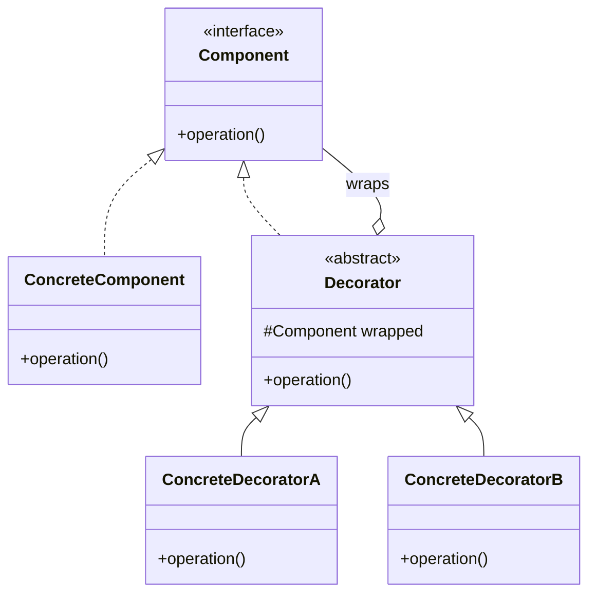
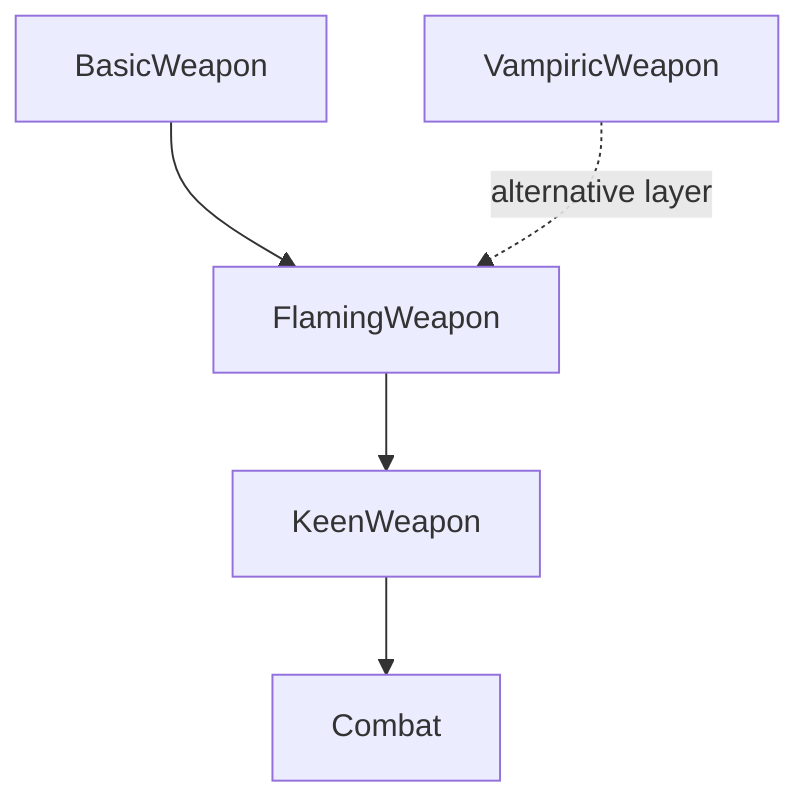

# Decorator Pattern

## Video Goal

Understand how the **Decorator pattern adds behavior to an existing object by wrapping it in another object that implements the same interface**. Learn why this is often more flexible than inheritance, how decorators support the Open/Closed Principle, and what tradeoffs come with composing objects this way.

## The Problem: Too Many Combinations

Imagine a dungeon game with weapons that can be flaming, frosty, or vampiric. Each enchantment adds a different ability: extra damage, a special effect, or health restoration.

The obvious approach is to create a subclass for each combination:

- `FlamingWeapon`
- `FrostWeapon`
- `FlamingFrostWeapon`
- `FlamingVampiricWeapon`
- `FlamingFrostVampiricWeapon`

And so the hierarchy grows. With \(N\) independently combinable features, there can be \(2^N - 1\) nonempty combinations. Three enchantments already require seven combination classes; five would require thirty-one.

Java's single inheritance makes this especially awkward: a class cannot inherit implementation from multiple classes to combine their behaviors. Even where a language permits multiple inheritance, a class for every possible combination is still a cumbersome design.

We could try to solve the problem with flags and conditional statements instead. But then every method that cares about an enchantment must inspect those flags, and every new feature risks adding another branch to the growing tangle.

**Decorator offers a different approach: instead of creating a class for every combination, wrap an object in one decorator for each feature you want.**

## The Core Idea

A decorator has two important characteristics:

1. It implements the same component interface as the object it wraps.
2. It holds a reference to that object and delegates to it, adding or changing selected behavior.

Because the wrapper has the same type as the wrapped object, the rest of the program can use either one without needing to know which it received.

Think of putting on layers of clothing. A coat does not turn you into a different person; it adds something to what you already are. You can add a scarf, a jacket, and a coat in different combinations without inventing a new human for every outfit.

In code, those layers can be stacked:

```java
Weapon weapon = new BasicWeapon("Iron Sword", 8);
weapon = new FlamingWeapon(weapon);
weapon = new VampiricWeapon(weapon);
```

The result is still a `Weapon`. It simply has additional behavior.

## The Structure of the Pattern

There are four principal roles:

- **Component:** The shared interface or abstract type that defines what clients can use.
- **Concrete Component:** The original object, providing the baseline behavior.
- **Decorator:** A wrapper that implements the component type, holds another component, and delegates behavior by default.
- **Concrete Decorator:** A specific wrapper that adds or changes one feature.

### UML Class Diagram



The most important relationship is the one between `Decorator` and `Component`. The decorator **is a component**, so it can be used wherever a component is expected; it **has a component**, so it can delegate to the object inside it.

That distinction is the heart of the pattern.

## How Does a Decorator Actually Work?

A well-designed decorator generally delegates everything it does not need to change and overrides only the behavior it wants to extend or replace.

For example:

```java
public abstract class WeaponDecorator implements Weapon {
    protected final Weapon wrapped;

    protected WeaponDecorator(Weapon wrapped) {
        this.wrapped = wrapped;
    }

    @Override
    public int getDamage() {
        return wrapped.getDamage();
    }

    @Override
    public int lifesteal() {
        return wrapped.lifesteal();
    }
}
```

A flaming decorator then changes just the damage calculation:

```java
public class FlamingWeapon extends WeaponDecorator {
    public FlamingWeapon(Weapon wrapped) {
        super(wrapped);
    }

    @Override
    public int getDamage() {
        return wrapped.getDamage() + 4;
    }
}
```

The wrapper delegates the ordinary behavior to the weapon beneath it and adds its own contribution where appropriate.

This gives us a useful rule of thumb: **delegate by default, override by exception.** If every decorator reimplements every method, we have recreated the duplication the pattern was supposed to remove.

## Adding Features Without Modifying Existing Code

Decorator is a natural example of the **Open/Closed Principle (OCP)**: software entities should be open for extension but closed for modification.

Suppose `Combat` calculates damage by calling:

```java
int damage = weapon.getDamage();
```

If `Combat` depends on the `Weapon` interface, it does not need to know whether the weapon is plain, flaming, or wrapped in several enchantments. Each decorator supplies the appropriate behavior through the same interface.

Adding a new `KeenWeapon` decorator can introduce a damage multiplier without requiring a new combination class or a change to `Combat`.



The important idea is not that no code ever changes. A new decorator must be implemented, and a registry or user interface may need wiring to make it available. Rather, **the existing code that uses the component can remain unchanged as new implementations are introduced**.

That is a practical expression of OCP, not a guarantee that every part of the system is automatically closed to modification.

## What Is Decoupled?

Decorator separates the code that **uses a capability** from the code that **implements or adds that capability**.

For example, `Combat` needs a weapon that can report its damage. It should not need to know which enchantments are present, how many wrappers exist, or which combination class represents them.

The concrete decorator owns its particular behavior. The shared interface allows the rest of the application to remain indifferent to the details.

This is also an example of programming to an abstraction rather than to a collection of concrete classes. Instead of writing conditional logic that checks every weapon subtype, client code simply calls the interface.

The pattern does not eliminate dependencies altogether. Each decorator still depends on the component abstraction, and the code constructing the wrappers must decide which decorators to apply.

## Composition Over Inheritance

Decorator demonstrates why **composition is often more flexible than inheritance when behavior needs to be combined dynamically**.

Inheritance establishes a relationship between a subclass and its parent. It is useful when the subclass represents a meaningful specialization, but its behavior is established through the class hierarchy.

Composition lets an object hold and collaborate with other objects. Decorator uses composition to build behavior in layers at runtime, while implementing the component interface so that each layer remains interchangeable with the original.

This leads to an important distinction:

- **Inheritance supplies the shared type relationship.**
- **Composition and delegation supply the layered behavior.**

Decorator still uses inheritance or interface implementation for its type relationships. It does not eliminate inheritance; it avoids relying on a separate subclass for every possible combination of features.

## Does Wrapping Order Matter?

Yes—and this is one of the pattern's most interesting properties.

Consider a weapon that deals 8 damage. A flaming enchantment adds 4 damage, while a keen enchantment multiplies damage by 1.5.

```java
Weapon first = new KeenWeapon(
    new FlamingWeapon(new BasicWeapon("Sword", 8))
);

Weapon second = new FlamingWeapon(
    new KeenWeapon(new BasicWeapon("Sword", 8))
);
```

Depending on how each decorator calculates its contribution, the results can differ:

- `Keen(Flaming(Sword))`: \( (8 + 4) \times 1.5 = 18 \)
- `Flaming(Keen(Sword))`: \( 8 \times 1.5 + 4 = 16 \)

A decorator operates on the object it wraps. It can see and use the behavior exposed by the layer underneath it; it does not automatically know what other layers may be placed above it.

This is not inherently a flaw. It is a modeling decision. If order affects behavior, the program should define that order deliberately and test it.

## Different Implementations of Decorator

The pattern is an idea, not a requirement to use one particular class structure.

### 1. Interface-Based Decorators

A component interface defines the operations, and both the concrete component and decorators implement it. This works well when the component does not need shared implementation or instance state from a common base class.

### 2. Abstract-Class Decorators

An abstract decorator implements the component interface and stores the wrapped object. It supplies default delegation, allowing concrete decorators to override only what they change.

This is useful when many decorators need the same forwarding logic. The component itself may be an interface or an abstract class.

### 3. Functional Wrappers and Lambdas

For very small, one-off behaviors, a lambda or function wrapper can sometimes express the same wrapping idea without introducing a named class for every operation. This is useful when the behavior is simple and the language's type system supports the required functional interface.

However, a lambda is not a replacement for every decorator. Named classes remain useful when behavior has identity, state, several methods, or domain-specific meaning.

### 4. Library and Framework Decorators

The pattern appears in ordinary software libraries. Java I/O streams, for example, can wrap other streams to add buffering, conversion, or other capabilities:

```java
new BufferedReader(
    new InputStreamReader(System.in)
);
```

The wrappers retain compatible interfaces while layering additional behavior. Once you recognize this structure, you will see it in many APIs.

**A note on Python:** Python's `@decorator` syntax is related by name and idea, but it is not identical to the GoF object-level pattern. Python commonly wraps functions or classes at definition time; the GoF pattern wraps objects through composition, typically at runtime. Both use wrapping to add behavior, but the level at which they operate differs.

## Decorator and Other Design Patterns

Decorator is easiest to understand when we distinguish it from patterns that may look similar.

| Pattern | Primary purpose |
|---|---|
| **Decorator** | Adds or changes behavior while preserving the component interface. |
| **Strategy** | Encapsulates an interchangeable algorithm or approach. |
| **State** | Encapsulates behavior that changes according to an object's current state. |
| **Adapter** | Converts one interface into another that a client expects. |
| **Proxy** | Controls access to an object while typically preserving its interface. |

Decorator and Proxy are especially easy to confuse because both wrap an object and can preserve its interface. The distinction is primarily one of intent: Decorator adds responsibilities; Proxy controls access to an existing object.

## When Should You Use Decorator?

Decorator is a good candidate when:

- An object needs optional features that can be combined in different ways.
- You want to add behavior at runtime rather than choose a subclass at compile time.
- A growing inheritance hierarchy is producing a class for every combination.
- You want to extend an implementation without changing the component's clients.
- Several features can be represented as independent wrappers around a common interface.

It is particularly useful when the possible combinations are numerous or open-ended. A new feature can be implemented as a new decorator instead of requiring every existing combination to be reconsidered.

## When Should You Avoid It?

Decorator is not automatically better than a straightforward implementation.

Avoid introducing it when the object has only one or two stable variations and ordinary inheritance or a simple conditional is clearer. A design pattern should reduce complexity, not merely relocate it into more files.

Be cautious when clients need to inspect concrete types, when wrapper construction becomes difficult to understand, or when the order of decorations creates subtle behavior that is hard to reason about.

Also remember that Decorator is not a general-purpose bug fix. It changes the structure through which behavior is composed; it does not automatically correct unrelated state-management, reference, or lifecycle problems.

## OOP Principles Represented

Decorator illustrates several central OOP ideas:

- **Encapsulation:** Each concrete decorator owns the details of its additional behavior.
- **Abstraction:** Clients depend on the component interface instead of concrete combinations.
- **Polymorphism:** A decorated object can be used anywhere the component type is expected.
- **Composition:** An object gains behavior by holding and delegating to another object.
- **Open/Closed Principle:** New capabilities can often be introduced without modifying established client code.
- **Single Responsibility Principle:** Each decorator can focus on one additional responsibility rather than implementing every possible combination.
- **Dependency Inversion:** High-level client code can depend on the component abstraction rather than on specific concrete implementations.

These principles reinforce one another. The interface makes the wrapper interchangeable; composition makes layering possible; delegation keeps the implementation focused; and polymorphism lets client code use the result without knowing its exact construction.

## Criticisms and Tradeoffs

A sound understanding of a pattern includes knowing what it costs.

1. **More classes and indirection.** Each feature may require its own decorator class, and tracing a method call through several wrappers takes effort.
2. **Construction can become noisy.** Deeply nested constructors are harder to read. A Factory, registry, or builder can centralize construction when appropriate.
3. **Concrete-type checks become unreliable.** A check such as `instanceof FlamingWeapon` may fail when that decorator is nested inside another wrapper. Clients should usually depend on the component's behavior rather than inspect its concrete class.
4. **Order can change semantics.** Wrapping order may affect calculations, side effects, and other behavior. That order needs to be intentional and tested.
5. **OCP has boundaries.** Decorator makes adding certain behaviors easier, but it does not guarantee that every new feature can be added without changing registries, configuration, interfaces, or client code.
6. **It can be overengineering.** If the combinations are few and unlikely to grow, a simpler design may be easier to maintain.

The right question is not whether Decorator is more sophisticated. It is whether it makes the likely changes in your system cheaper, clearer, and safer.

## DungeonForge Connection

DungeonForge uses Decorator to let weapon enchantments stack without requiring a new class for every combination.

- `Weapon` defines the shared component interface.
- `BasicWeapon` supplies the unenchanted weapon.
- `WeaponDecorator` provides the common wrapping and delegation behavior.
- `FlamingWeapon`, `FrostWeapon`, `VampiricWeapon`, and `KeenWeapon` add specific capabilities.
- `EnchantmentRegistry` provides a central place to associate enchantment names with their decorators.

A weapon can therefore be built by wrapping it in one or more decorators. `Combat` continues to depend on `Weapon`, not on the particular enchantments or the order in which the classes were created.

The result is not just fewer classes. It is a clearer allocation of responsibility: each enchantment knows its own behavior, and the combat system does not need to know how the weapon acquired it.

## The Pattern in One Sentence

**Decorator adds responsibilities to an object by wrapping it in another object of the same type, allowing features to be combined without creating a subclass for every combination.**

## The Mental Model

Think of Decorator as a stack of transparent layers.

Every layer has the same public face as the object underneath it, delegates the behavior it does not change, and contributes its own behavior where needed. The outside world sees the same abstraction; inside, the object has acquired new capabilities.

The art is in choosing layers that are genuinely independent, preserving a clear interface, and knowing when the flexibility is worth the extra structure.